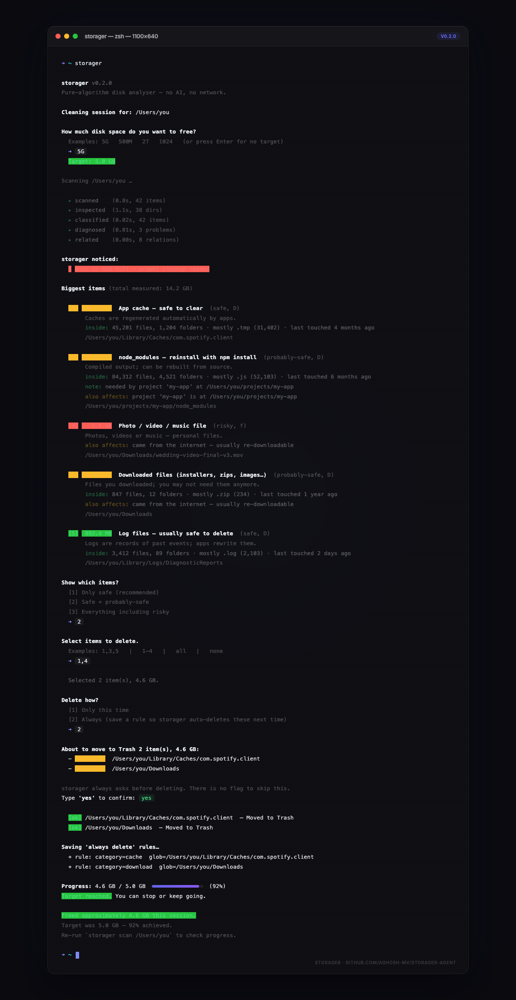

# storager

**Pure-algorithm disk space analyser.** No AI, no network, no telemetry.

`storager` walks your filesystem, measures what is eating your disk, **peeks inside each folder** to explain what it actually contains, names every big item in plain language, warns you about problems, shows what else is connected to each item, and **always asks before deleting anything**.

---



---

## Install

From the public repo:

```bash
git clone https://github.com/Aghosh-mv/storager-agent.git
cd storager-agent
pip install .
```

After that, `storager` is a global command:

```bash
storager --version
```

---

## Quick start

```bash
storager              # bare command → interactive clean on current directory
storager ~            # clean your home directory
storager clean ~      # same thing, explicit
```

**storager first asks how much space you want to free** (e.g. `5G`, `500M`, `2T`), then scans, explains everything, and guides you until you hit that target.

---

## What it does

| Stage | What happens |
|---|---|
| **Scan** | Measures sizes of everything under your target directory. Uses parallel threads on large trees, sequential on small ones (auto-decides). |
| **Inspect** | Peeks inside each folder: counts files by type, finds oldest/newest, lists biggest files. |
| **Classify** | Names every item in plain English + assigns a risk level (safe / probably-safe / risky / unknown). |
| **Diagnose** | Finds problems: disk almost full, stale caches, empty folders, duplicate files, huge single files. |
| **Relate** | Shows connections: "deleting this node_modules affects project X at /path". |
| **Present** | Renders a colour-coded table with a one-liner summary of what's inside each item. |
| **Confirm** | **Hard gate — always asks before deleting. No flag skips this.** |
| **Delete** | Moves to system Trash by default. `--hard` for permanent deletion. |
| **Report** | End-of-session summary: freed bytes, target progress. |

---

## Commands

| Command | What it does |
|---|---|
| `storager scan [path]` | Scan and explain — no deletion. |
| `storager clean [path]` | Interactive clean with target prompt. |
| `storager rules` | List / add / remove persistent rules. |
| `storager version` | Print version. |

### Flags

| Flag | Effect |
|---|---|
| `--top N` | Max items to consider (default: 30 scan / 50 clean) |
| `--target 5G` | Skip the target prompt, aim for 5 GB |
| `--no-prompt` | No target, just clean |
| `--hard` | Permanently delete (skip Trash) |
| `--trace` | Print stage timing as it runs |
| `--parallel auto\|sequential\|N` | Force parallel mode (default: auto-decides) |
| `--all` | Show risky items in scan output |

---

## Fact-packs (extensibility)

Drop a `.py` file in `~/.config/storager/facts/` and restart `storager`. Any file defining a `FACTS` list of functions gets loaded:

```python
# ~/.config/storager/facts/steam.py
def steam_fact(path):
    if path.name == "steamapps":
        return ["Steam game files — re-downloadable from your Steam library"]
    return []

FACTS = [steam_fact]
```

No PR, no fork, no editing storager's code. Your pack loads on next run.

---

## Safety

- **Trash by default.** Nothing is permanently deleted unless you pass `--hard`.
- **Always asks.** The confirm gate cannot be skipped by any flag, env var, or config.
- **Saved rules still ask.** Even "always delete" rules print what they're about to do and wait for `yes`.
- **No network.** storager never phones home.
- **No AI / no models.** Classification is a deterministic, ordered rule list — inspectable in `storager/classifier.py`.

---

## Adaptive parallelism

storager decides by itself whether to use threads:

- **< 30 items** → sequential (threads would just add overhead)
- **≥ 30 directories on a fast disk** → parallel, up to 8 threads
- **`--parallel sequential`** → force single-threaded (debugging)
- **`--parallel 4`** → force exactly 4 threads

`--trace` shows the decision and timing per stage.

---

## Architecture

```
storager/
  cli.py        → thin: parse args → run pipeline → print
  session.py    → one typed object that flows through everything
  pipeline.py   → ordered stages + parallel runner + trace
  scanner.py    → parallel/sequential size measurement
  inspector.py  → peek inside: count by type, age, biggest files
  facts.py      → fact registry (internal + external packs)
  classifier.py → name + risk (ordered rules)
  diagnose.py   → problem detection
  graph.py      → connection/relation mapping
  present.py    → plain-language rendering
  confirm.py    → hard "always ask" gate
  deleter.py    → trash / hard delete
  report.py     → session summary
  rules.py      → persistent always-delete rules
```

Each stage is a pure function: `def stage(session) -> None` — reads from the session, writes new data, never mutates another stage's output.

---

## License

**Private Use License** — see [LICENSE](LICENSE).

You may view, download, run, clone, and modify for your own private use. You may **not** publicly distribute modified versions, forks, or derivative works.
